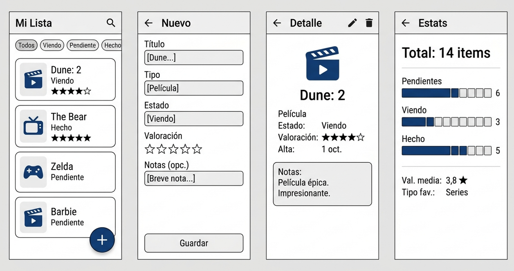

# Mi Watchlist

Aplicación Flutter para llevar la cuenta de las **películas, series y videojuegos** que quieres ver o jugar, los que tienes a medias y los que ya has terminado.

Proyecto del módulo de Desarrollo de Interfaces.

## Funcionalidades

- **Lista principal** con icono según el tipo, estado y valoración con estrellas.
- **Alta y edición** con un mismo formulario validado (título obligatorio, máximo 60 caracteres).
- **Detalle** de cada elemento, con opciones para editar y borrar (con confirmación).
- **Filtro por estado** (Todos, Pendiente, Viendo, Terminado) y **búsqueda por título** sin distinguir mayúsculas, que funcionan a la vez.
- **Persistencia**: los datos se guardan en el dispositivo y se recuperan al abrir la app.
- **Estadísticas**: total, recuento por estado con barras, valoración media y tipo más frecuente.
- **Tema propio** generado con `ColorScheme.fromSeed`.

## Captura

docs/boceto.png



## Cómo ejecutarla

Requisitos: [Flutter](https://docs.flutter.dev/get-started/install) instalado (probado con Flutter 3.47).

```bash
# 1. Descargar las dependencias
flutter pub get

# 2. Ejecutar en Chrome o en un dispositivo Android conectado
flutter run -d chrome
flutter run

# 3. Pasar las pruebas
flutter test
```

Para generar una versión instalable:

```bash
flutter build apk --debug   # APK de Android
flutter build web           # versión web
```

> **Windows:** para compilar con plugins (como `shared_preferences`) hay que activar el **Modo de desarrollador** en la configuración del sistema.

## Paquetes usados

| Paquete | Para qué |
| --- | --- |
| [`shared_preferences`](https://pub.dev/packages/shared_preferences) | Guardar la lista en el dispositivo como JSON. |
| `flutter_test` (incluido en Flutter) | Pruebas unitarias y de widget. |
| `flutter_lints` (desarrollo) | Reglas de estilo para el análisis del código. |

No se usa ningún paquete de gestión de estado: todo funciona con `StatefulWidget` y `setState`.

## Estructura

```text
lib/
├── main.dart                     # Arranque y tema
├── modelos/
│   └── elemento.dart             # Clase Elemento y enums Tipo y Estado
├── servicios/
│   └── almacen.dart              # Guardar y cargar con shared_preferences
├── pantallas/
│   ├── pantalla_lista.dart       # Lista, filtro y búsqueda
│   ├── pantalla_formulario.dart  # Alta y edición
│   ├── pantalla_detalle.dart     # Detalle y borrado
│   └── pantalla_estadisticas.dart
└── widgets/
    ├── tarjeta_elemento.dart     # Tarjeta de la lista
    └── selector_estrellas.dart   # Estrellas de solo lectura o interactivas
test/
├── elemento_test.dart            # toJson/fromJson y copyWith
└── formulario_test.dart          # Validación del título
```

## Pruebas

- `test/elemento_test.dart`: comprueba que `fromJson(toJson(e))` devuelve los mismos datos y que `copyWith` solo cambia lo indicado.
- `test/formulario_test.dart`: pulsa Guardar con el título vacío y comprueba que aparece el mensaje de error.

## Autoría

- Alumno/a: _Guillermo_
- Uso de IA documentado en [`docs/bitacora_ia.md`](docs/bitacora_ia.md).
